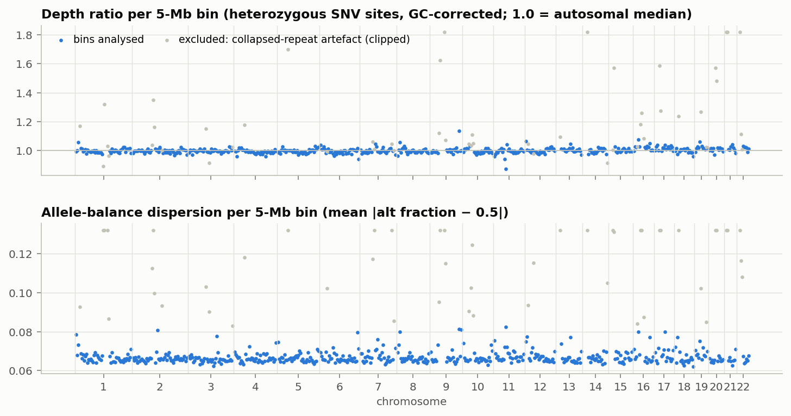
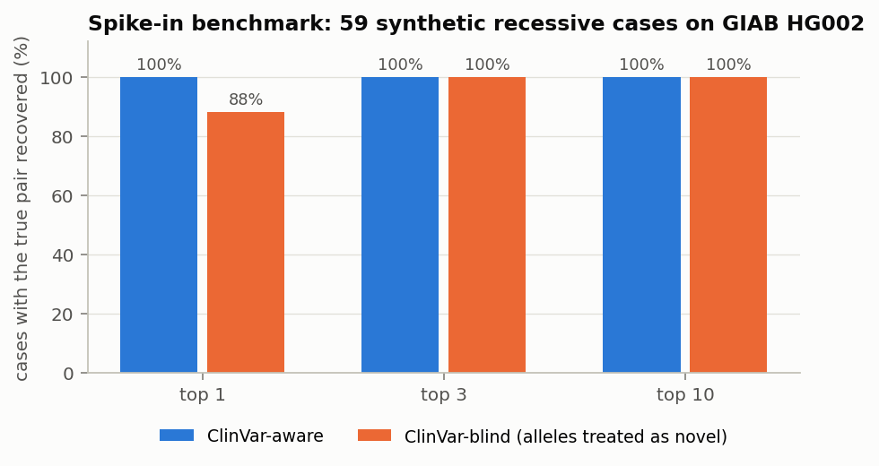

# rusheel86 — Track 1 methods report: duorank-v1

*Rare Disease, Real Kid: MVA Hackathon 2026 · generated automatically by the analysis notebook on 2026-10-22 12:15 UTC · mode: CHALLENGE (gated dataset)*

## Summary

We built **DuoRank**, a fully automated, public-data-only pipeline that ranks genotype hypotheses — homozygous, compound-heterozygous, heterozygous and hemizygous — from a single-sample GRCh38 VCF and a list of HPO terms. Variants are normalised and annotated offline (gnomAD v4.1, ClinVar, MANE consequences, AlphaMissense), scored in the Bayesian point system of the ACMG/AMP guidelines (evidence strengths from published ClinGen calibrations; the few ranking heuristics fixed before the run and listed in section 7), and combined with a gene-level phenotype fit computed by information-content similarity against all 12867 annotated Mendelian diseases. A short list is then re-annotated (Ensembl VEP, exact gnomAD records, SpliceAI, ESM-2, AlphaFold structure), phase is analysed, and the raw reads are optionally re-aligned around the leading locus for independent validation.

**Result.** The leading hypothesis is a **compound-het genotype in BUB1B** (Mosaic variegated aneuploidy syndrome 1, AR): `chr15:40209701 T>G` (c.2210T>G p.Leu737Ter, automated class **Likely pathogenic**) + `chr15:40220612 T>G` (c.3006T>G p.Asn1002Lys, automated class **Uncertain significance**), EPCR 0.426. Without the stated diagnosis (HPO terms only) the gene ranks #2 of 5390 on phenotype alone and the same genotype is still ranked first. The best hypothesis in any other gene is a heterozygous model in a gene outside the indication (name withheld) with EPCR 0.116 (3.7-fold lower than the leading pair). 6 lower-ranked alternative genotypes within BUB1B follow (other pairings and single alleles); 2 of them are submitted as fall-back rows so that a partially correct answer still scores (a single allele already listed in a higher pair, and any variant with net benign evidence, are not submitted).

## 1. Data and question

* Proband genome: single-sample WGS VCF, GRCh38 (Sentieon Haplotyper + GATK hard filters); raw FASTQ (4 lanes, paired).
* Phenotype (HPO): Rhabdomyosarcoma (HP:0002859); Nephrocalcinosis (HP:0000121); Short stature (HP:0004322); Failure to thrive (HP:0001508); Skeletal muscle atrophy (HP:0003202); Premature birth (HP:0001622); Small for gestational age (HP:0001518). Terms that describe relatives rather than the proband were excluded from the similarity and are not listed here.
* Stated clinical indication (used as a transparent prior, both rankings reported): mosaic variegated aneuploidy
* Genome QC: Ti/Tv 2.01, het/hom 1.63, median depth at het sites 44×, inferred sex male (XY), autozygosity F_ROH 0 (no evidence of parental relatedness).

## 2. Method

| Step | What is done | Key choices |
|---|---|---|
| Normalise | primary chromosomes, `chr` names, split multi-allelics, left-align (`bcftools norm`) | exact allele representation matches the scorer |
| Rarity | gnomAD v4.1 joint exomes+genomes (echtvar archive, Zenodo 22297079): AF, grpmax FAF95, homozygotes | ClinVar P/LP alleles exempt below 5 % (founder / hypomorphic alleles); VCF `INFO/AF` (within-sample) never used |
| Consequence | `bcftools csq` on MANE v1.5 transcripts; automated PVS1 / NMD rule | last-exon and 50-nt rule; LoF mechanism from ClinVar |
| Missense | AlphaMissense, ClinGen-calibrated bands (one predictor only; REVEL/CADD shown, not counted) | avoids double counting |
| Splicing | SpliceAI (pre-computed via VEP and re-run on GPU over a ±500 bp window for the leading genes) | non-coding second hits are scored, not filtered |
| Phenotype | Resnik best-match similarity vs 12867 HPO-annotated diseases (HPO hp/releases/2026-09-01) | relatives' terms excluded; indication used as a panel prior |
| Genotypes | hom / comp-het / het / hemi per gene; EPCR = P(genotype) × phenotype fit × mode fit × call quality | PM3 per ClinGen SVI; phase factor from read-backed tags |
| Second-hit rescue | rare non-coding variants in and around genes that already carry one credible allele | catches regulatory / deep-intronic hypomorphs |
| Output | top hypothesis + within-gene alternatives; other genes only if EPCR ≥ 0.25 | file parsed and self-scored by a re-implementation of the organisers' evaluation script before saving |

## 3. The leading hypothesis in detail

| | allele 1 | allele 2 |
|---|---|---|
| GRCh38 | chr15:40209701 T>G | chr15:40220612 T>G |
| HGVS (MANE) | NM_001211.6:c.2210T>G p.Leu737Ter | NM_001211.6:c.3006T>G p.Asn1002Lys |
| consequence | stop_gained, exon 17/23; NMD predicted | missense, exon 23/23 |
| genotype / reads | het, AD 21.0/25.0, GQ 99, FILTER PASS | het, AD 15.0/13.0, GQ 99, FILTER PASS |
| gnomAD v4.1 | AC 120 / AN 1.61e+06, homozygotes 0, FAF95 8.34e-05 | AC 1 / AN 1.61e+06, homozygotes 0, FAF95 – |
| ClinVar | Pathogenic/Likely pathogenic (criteria provided, multiple submitters, no conflicts) | not in ClinVar |
| AlphaMissense / REVEL / CADD | – / – / 36 | 0.923 / 0.472 / 24.5 |
| SpliceAI max Δ | 0.03 | 0 |
| ACMG points → posterior | 9 → 0.988 | 3 → 0.500 |
| automated classification | **Likely pathogenic** | **Uncertain significance** |

*Allele 1 evidence:* PM2_supporting (+1: gnomAD AF or FAF95 (the higher) 8.3e-05 <= 1e-4, no homozygotes); ClinVar_2star (+0: ClinVar Pathogenic/Likely_pathogenic (2-star): posterior >= 0.95); PVS1 (+8: stop_gained; nonsense-mediated decay predicted)

*Allele 2 evidence:* PM2_supporting (+1: gnomAD AF or FAF95 (the higher) 6.2e-07 <= 1e-4, no homozygotes); PP3_moderate (+2: AlphaMissense 0.923)

**Phenotype fit.** BUB1B → Mosaic variegated aneuploidy syndrome 1 (similarity 0.63); rank #2 of 5390 genes on HPO terms alone. Green gene on 10 Genomics England PanelApp panels, including Hydrocephalus, Familial rhabdomyosarcoma, Childhood solid tumours, Childhood solid tumours cancer susceptibility.

**Is the weaker allele a coincidental bystander?** In gnomAD v4.1, 1222 rare (< 0.01 %) missense variants in BUB1B have a cumulative frequency of 0.0052, so an unrelated person carries one by chance with probability ≈ 0.010 (≈ 0.0002 counting only alleles at least as damaging by AlphaMissense). Given a pathogenic first allele, the posterior that this allele is the second causal allele (rather than a bystander next to an undetected second hit) is 0.990 with an even prior on 'second hit visible as a rare coding variant', and 0.960 with a sceptical prior of 0.2.

**Protein language model (orthogonal, not counted in the points).** ESM-2 650M log-likelihood ratio for N1002K: -5.81 (the gene has only 0 ClinVar P/LP missense allele(s), too few for a gene-specific reference). On its own this is moderate, not decisive, evidence of damage — consistent with a hypomorphic rather than a null allele, which is what a second allele in a recessive disorder whose null/null genotype is lethal is expected to be.

**Structure.** Residue 1002 lies in: Protein kinase (766-1050); AlphaFold pLDDT 91.1 (20 residues within 10 Å). Nearest ClinVar P/LP missense residues: 467 (137.6 Å). UniProt lists 7 literature-reported patient missense alleles in the protein; the nearest are L1012P (MVA1, 12.3 Å), I909T (MVA1, 24.4 Å), L844F (MVA1, 25.7 Å) — reported MVA1 missense alleles cluster around this residue in the same domain, the expected location of a second, hypomorphic allele. 

**Phase.** not phaseable with short reads: the alleles are 10,911 bp apart and the chain of heterozygous sites is broken by a gap of 6,769 bp (read pairs link at most ~600 bp). The alleles are 10911 bp apart with 1 heterozygous call(s) between them in the provided VCF (largest gap 6769 bp; the read-level re-call below counts sites independently). Trans configuration is therefore **inferred, not observed**; it would be confirmed by testing either parent for the two alleles (the standard clinical route); or a single long-range PCR amplicon of ~11.9 kb spanning both sites, read on a long-read platform; or, because the alleles are only 796 nt apart in the mRNA, one RT-PCR amplicon from the child's cultured cells with an NMD inhibitor (see the Track 2 report).

**Read-level validation from the raw FASTQ.** 4 lane(s) streamed through unique-minimizer recruitment; 448,264 recruited reads re-aligned genome-wide. Control-window depth 44.8× on autosomes; chrX/autosome depth 0.49 (expected 0.5 in a male, which validates the depth method for one-copy changes). chr15:40209701 T>G stop_gained p.Leu737Ter: 25/46 alt reads (fraction 0.543; strands +13/-12; lanes {'4': 6, '2': 7, '1': 7, '3': 5}; original VCF AD 21/25). chr15:40220612 T>G missense p.Asn1002Lys: 12/27 alt reads (fraction 0.444; strands +4/-8; lanes {'3': 4, '1': 4, '4': 3, '2': 1}; original VCF AD 15/13). Independent re-calling (bcftools) recovered 99 % of the 145 PASS heterozygous SNVs of the provided VCF in the targets, and the leading alleles: {'chr15:40209701 T>G stop_gained p.Leu737Ter': True, 'chr15:40220612 T>G missense p.Asn1002Lys': True}. Depth along BUB1B: no run of low-depth bins (no exon-scale deletion); clipped-read clusters: 6; discordant-pair clusters: 3. Between the two alleles the independent re-call finds 1 heterozygous SNV site(s) (the provided VCF lists 1); 2 of the 2 consecutive site pairs are linked by no read pair (largest gap 6,769 bp): the reads cannot phase the alleles.

**Why this genotype fits the known biology.** MVA1 is caused by biallelic BUB1B variants, typically one truncating allele with one missense allele, often in the kinase domain (Hanks S et al. 2004, *Nat Genet* (PMID 15475955); Matsuura S et al. 2006, *Am J Med Genet A* (PMID 16411201)). A complete loss of BubR1 is embryonic-lethal in mice, so live-born patients keep some function, and BubR1 dosage tracks the phenotype: a graded reduction first causes premature chromatid separation and then aneuploidy (Bohers E et al. 2008, *Hum Genet* (PMID 18932004)), and hypomorphic mice age prematurely (Baker DJ et al. 2004, *Nat Genet* (PMID 15208629)). Patient kinase-domain missense proteins are unstable rather than catalytically dead (Suijkerbuijk SJ et al. 2010, *Cancer Res* (PMID 20516114)). The child's pair — a predicted-NMD nonsense allele with a kinase-domain missense allele — is therefore the expected null + hypomorph architecture. Some families carry a regulatory BUB1B allele instead (Ochiai H et al. 2014, *Proc Natl Acad Sci U S A* (PMID 24344301)); this is why rare non-coding variants around genes with one credible allele are rescued and scored.

**Path to a firm classification of p.Asn1002Lys.** Points are applied cumulatively (Tavtigian point scale; PM3 per ClinGen SVI):

| step | points | posterior | classification |
|---|---|---|---|
| current automated evidence (phase unknown) | 3 | 0.5 | Uncertain significance |
| + PM3 confirmed in trans (partner allele Likely pathogenic; parental testing or the cDNA amplicon) | 4 | 0.675 | Uncertain significance |
| + PP4: phenotype highly specific for the gene's disorder (ClinGen caveats for heterogeneous disorders apply) | 5 | 0.812 | Uncertain significance |
| + PS3_moderate: allele-specific readout in the child's cells (peptides from this allele's protein; its half-life) shows reduced protein or function | 7 | 0.949 | Likely pathogenic |

**What a clinical laboratory would do to confirm.** (1) Sanger confirmation of both alleles. (2) Phase: targeted testing of either parent (the standard route, which also supplies PM3); or, because the alleles are only 796 nt apart in the mRNA, one RT-PCR amplicon from cultured cells with an NMD inhibitor — Primer3 primers are given in the Track 2 report. (3) Function: BUBR1 protein level and mitotic-checkpoint competence in the child's cells (PS3), and premature chromatid separation / mosaic aneuploidy on cytogenetics (PP4). (4) Cascade testing for carriers in the family, offered through the clinical team.

**Submitted rows**

| proband_id | chrom_1 | pos_1 | ref_1 | alt_1 | chrom_2 | pos_2 | ref_2 | alt_2 | epcr | finding_type | notes |
|---|---|---|---|---|---|---|---|---|---|---|---|
| PROBAND01 | chr15 | 40209701 | T | G | chr15 | 40220612 | T | G | 0.4261 | primary | BUB1B compound-het; phase unknown |
| PROBAND01 | chr15 | 40209701 | T | G | chr15 | 40216470 | A | G | 0.0852 | primary | BUB1B compound-het; phase unknown |
| PROBAND01 | chr15 | 40216470 | A | G | chr15 | 40220612 | T | G | 0.0431 | primary | BUB1B compound-het; phase unknown |

## 4. How robust is the ranking?

* Every heuristic weight multiplied by a random factor in [½, 2] (300 runs): the top hypothesis is unchanged in 93 % of runs (worst rank 3).
* Rank of the leading genotype without ClinVar: 1; without the missense predictor: 1; without the stated diagnosis: 1; without both ClinVar and the diagnosis: 1.
* Leave-one-HPO-term-out (diagnosis-blind): Rhabdomyosarcoma → rank 1, Nephrocalcinosis → rank 1, Short stature → rank 1, Failure to thrive → rank 1, Skeletal muscle atrophy → rank 1, Premature birth → rank 1, Small for gestational age → rank 1.
* The best hypothesis in any other gene is a heterozygous model in a gene outside the indication (name withheld) with EPCR 0.116 (3.7-fold lower than the leading pair). 6 lower-ranked alternative genotypes within BUB1B follow (other pairings and single alleles); 2 of them are submitted as fall-back rows so that a partially correct answer still scores (a single allele already listed in a higher pair, and any variant with net benign evidence, are not submitted).
* Hypotheses in genes outside the stated indication are counted but not named in this report: the organisers are still deciding, with the IRB, how incidental findings about this child may be published.

## 5. What the bulk genome can say about the aneuploidy itself

Per-chromosome depth (GC-corrected) and allele-balance dispersion at heterozygous SNVs showed no chromosome-wide imbalance passing the pre-set threshold (flagged chromosomes: none; 50 collapsed-repeat bins excluded; the largest deviations, chromosome(s) 19, 16, 22 at |z| ≤ 3.1, stay below the threshold of 4 and the raw depth still correlates with GC content (r = 0.379), so residual GC bias is the likelier explanation). With a between-chromosome SD of 0.01 in depth ratio, a clonal whole-chromosome gain or loss present in more than ~8 % of cells would have been detected. This is the expected result in mosaic *variegated* aneuploidy: different cells carry different gains and losses, which average out in bulk DNA. Bulk WGS can therefore neither confirm nor exclude the cytogenetic phenotype — metaphase karyotyping, interphase FISH or single-cell low-pass sequencing are the appropriate assays.

## 6. Does it generalise?

On 59 synthetic recessive cases spiked into the public GIAB HG002 genome (ClinVar truncating + missense pair; 6 sampled HPO terms with imprecision and one noise term; no diagnosis given), the true pair was ranked first in 100 % (95 % CI 94–100) (top-10: 100 %) of cases, and in 88 % (95 % CI 77–94) (top-10: 100 %) when the spiked alleles' ClinVar records were hidden. The benchmark uses only public data and is regenerated by the notebook. It is deliberately simple and therefore optimistic: the HPO terms are sampled from the same annotations that the phenotype engine scores, every case is a coding truncating + missense recessive pair, the hidden alleles are still ones on which the missense predictor's calibration was built, and a GIAB benchmark genome is cleaner than a clinical callset. It shows that the machinery works end to end, not the accuracy to expect on an unsolved case.

## 7. Limitations

* Phase of the two alleles is inferred from the genetic model and population data, not observed; parental testing or a long-read amplicon would settle it.
* The missense allele remains a variant of uncertain significance by automated ACMG criteria; its causal role rests on the pair-level argument (rarity, predictor, kinase-domain location, phenotype match).
* Structural variants and repeat expansions genome-wide are not assessed (read-level screen covers the leading locus only).
* Phenotype similarity depends on the completeness of HPO annotations (several of the child's features are not annotated to the disorder).
* EPCR is a ranking score on a probability scale (an ACMG posterior × phenotype, mode, phase and quality factors). It is not normalised across hypotheses (a single allele and a pair containing it overlap) and it is not calibrated against clinical outcomes, so it orders hypotheses rather than stating a clinical risk.
* Robustness checks perturb the heuristic weights, not the ACMG prior and odds, which dominate the score.

**Where every number comes from.** Literature parameters were taken as published; heuristic ones were fixed before the challenge data were opened and not changed afterwards.

| parameter | value | source |
|---|---|---|
| ACMG evidence → points → posterior | Bayesian point scale, prior 0.10, OddsPath 350 | Tavtigian 2018 / 2020 (literature) |
| Missense predictor bands (PP3 / BP4) | AlphaMissense and REVEL thresholds | Pejaver 2022 ClinGen calibration (literature) |
| PM2 / BS1 / BA1 frequency cut-offs | ≤ 1e-4 / > 1e-3 / ≥ 5 % (max of AF and FAF95) | ClinGen SVI recommendations (literature) |
| PM3 for the weaker allele | +2 with a Pathogenic partner, +1 with a Likely pathogenic one, 0 when phase is unknown | ClinGen SVI PM3 v1.0 (literature) |
| PVS1 / NMD | last-exon and 50-nt rules | Abou Tayoun 2018 (literature) |
| Phenotype factor | (similarity / best similarity)^3 | heuristic, fixed before the run |
| Mode-of-inheritance and phase factors | e.g. 0.9 for unphased pairs | heuristic, fixed before the run |
| Indication prior | genes on the stated diagnosis' panel floored at 0.95 of the best fit | heuristic, fixed before the run; both rankings reported |
| Other-gene rows in the CSV | only when EPCR ≥ 0.25 | heuristic, fixed before the run |

## 8. Data handling and AI disclosure

* All genotype-scale files lived in ephemeral scratch storage and were deleted at the end of the run; only findings (this report, the ranked CSV, figures) were kept. Only short lists of candidate variants were sent to public annotation services (Ensembl VEP, gnomAD), no genotype tables.
* Generative AI: Anthropic Claude Code (Claude Opus 5.5, Claude Opus 5 and Claude Sonnet 5.5), Claude Pro plan, was used to design and write this pipeline, and to draft the text that it renders into this report. Every literature claim was checked against the cited record before it was included. The model-training opt-out was enabled and no output ratings or feedback were submitted.

## 9. Methods-template answers

| Question | Answer |
|---|---|
| Team name | rusheel86 |
| Model number | 1 (duorank-v1) |
| Generative AI used | Anthropic Claude Code (Claude Opus 5.5, Claude Opus 5 and Claude Sonnet 5.5), Claude Pro plan, was used to design and write this pipeline, and to draft the text that it renders into this report. Every literature claim was checked against the cited record before it was included. The model-training opt-out was enabled and no output ratings or feedback were submitted. |
| Automated output or manual curation? | Fully automated output of the notebook; no manual review or re-ranking. Evidence strengths follow published ClinGen calibrations; the remaining heuristics (section 7) were fixed before the challenge data were opened; no parameter was tuned on leaderboard feedback. |
| Public data only? | Yes: gnomAD v4.1, ClinVar, MANE, Ensembl VEP, AlphaMissense, SpliceAI, ESM-2, AlphaFold DB, UniProt, HPO, PanelApp, GIAB HG002 (benchmark). |
| Compound heterozygous pairs? | Yes — pairs are enumerated per gene and scored jointly with a phase factor; single alleles are kept as fall-back rows. |
| Secondary / incidental findings | Dominant cancer-predisposition and other genes are evaluated as competing primary hypotheses; no secondary rows are submitted and names of genes outside the indication are withheld pending the organisers' IRB guidance. |
| Run time and cost | 70 min on a free Kaggle notebook (4 vCPU, no GPU); no paid compute. |

## 10. Run log

| stage | status | minutes | note |
|---|---|---|---|
| install tools | ok | 1.2 |  |
| download public resources | ok | 4.6 |  |
| prepare reference, gene models, ClinVar | ok | 1.4 |  |
| phenotype engine (load HPO) | ok | 0 |  |
| case data | ok | 0.2 |  |
| QC / sex / autozygosity / aneuploidy screen | ok | 0.6 |  |
| normalise + annotate | ok | 3.6 |  |
| phenotype scoring | ok | 0 |  |
| first-pass ranking | ok | 0 |  |
| robustness analysis | ok | 0.3 |  |
| write + validate submission (first pass) | ok | 0 |  |
| deep annotation of the short list | ok | 2.4 |  |
| leading hypothesis: evidence tables, panel status, chance-bystander analysis | ok | 0.1 |  |
| write + validate submission (after deep annotation) | ok | 0 |  |
| SpliceAI on the leading genes (GPU) | ok | 12.5 |  |
| ESM-2 missense landscape of the leading protein (GPU) | ok | 1.4 |  |
| AlphaFold structural context of the missense allele | ok | 0 |  |
| phase analysis | ok | 0 |  |
| spike-in benchmark (public genome) | ok | 5.1 |  |
| Track 2: drug-repurposing evidence | ok | 0.4 |  |
| Track 2: allele-level therapeutic triage | ok | 1.7 |  |
| Track 2: triage validation on published alleles | ok | 0 |  |
| write reports | ok | 0.1 |  |
| read-level evidence from the raw FASTQ | ok | 34.6 |  |

## References (resolved live from Europe PMC)

* Hanks S et al. 2004, *Nat Genet* (PMID 15475955) — Constitutional aneuploidy and cancer predisposition caused by biallelic mutations in BUB1B.
* Matsuura S et al. 2006, *Am J Med Genet A* (PMID 16411201) — Monoallelic BUB1B mutations and defective mitotic-spindle checkpoint in seven families with premature chromatid separation (PCS) syndrome.
* Ochiai H et al. 2014, *Proc Natl Acad Sci U S A* (PMID 24344301) — TALEN-mediated single-base-pair editing identification of an intergenic mutation upstream of BUB1B as causative of PCS (MVA) syndrome.
* Suijkerbuijk SJ et al. 2010, *Cancer Res* (PMID 20516114) — Molecular causes for BUBR1 dysfunction in the human cancer predisposition syndrome mosaic variegated aneuploidy.
* Bohers E et al. 2008, *Hum Genet* (PMID 18932004) — Gradual reduction of BUBR1 protein levels results in premature sister-chromatid separation then in aneuploidy.
* Kops GJ et al. 2004, *Proc Natl Acad Sci U S A* (PMID 15159543) — Lethality to human cancer cells through massive chromosome loss by inhibition of the mitotic checkpoint.
* Baker DJ et al. 2004, *Nat Genet* (PMID 15208629) — BubR1 insufficiency causes early onset of aging-associated phenotypes and infertility in mice.
* Baker DJ et al. 2013, *Nat Cell Biol* (PMID 23242215) — Increased expression of BubR1 protects against aneuploidy and cancer and extends healthy lifespan.
* North BJ et al. 2014, *EMBO J* (PMID 24825348) — SIRT2 induces the checkpoint kinase BubR1 to increase lifespan.
* Choi E et al. 2009, *EMBO J* (PMID 19407811) — BubR1 acetylation at prometaphase is required for modulating APC/C activity and timing of mitosis.
* Suijkerbuijk SJ et al. 2012, *Dev Cell* (PMID 22698286) — The vertebrate mitotic checkpoint protein BUBR1 is an unusual pseudokinase.
* Suijkerbuijk SJ et al. 2012, *Dev Cell* (PMID 23079597) — Integration of kinase and phosphatase activities by BUBR1 ensures formation of stable kinetochore-microtubule attachments.
* Laberko A et al. 2019, *Orphanet J Rare Dis* (PMID 31053147) — Hematopoietic stem cell transplantation in a patient with type 1 mosaic variegated aneuploidy syndrome.
* Tavtigian SV et al. 2018, *Genet Med* (PMID 29300386) — Modeling the ACMG/AMP variant classification guidelines as a Bayesian classification framework.
* Tavtigian SV et al. 2020, *Hum Mutat* (PMID 32720330) — Fitting a naturally scaled point system to the ACMG/AMP variant classification guidelines.
* Abou Tayoun AN et al. 2018, *Hum Mutat* (PMID 30192042) — Recommendations for interpreting the loss of function PVS1 ACMG/AMP variant criterion.
* Pejaver V et al. 2022, *Am J Hum Genet* (PMID 36413997) — Calibration of computational tools for missense variant pathogenicity classification and ClinGen recommendations for PP3/BP4 criteria.
* Bergquist T et al. 2025, *Genet Med* (PMID 40084623) — Calibration of additional computational tools expands ClinGen recommendation options for variant classification with PP3/BP4 criteria.
* Whiffin N et al. 2017, *Genet Med* (PMID 28518168) — Using high-resolution variant frequencies to empower clinical genome interpretation.
* Stenton SL et al. 2024, *Hum Genomics* (PMID 38685113) — Critical assessment of variant prioritization methods for rare disease diagnosis within the rare genomes project.
* Snape K et al. 2011, *Nat Genet* (PMID 21552266) — Mutations in CEP57 cause mosaic variegated aneuploidy syndrome.
* Yost S et al. 2017, *Nat Genet* (PMID 28553959) — Biallelic TRIP13 mutations predispose to Wilms tumor and chromosome missegregation.
* de Wolf B et al. 2021, *EMBO J* (PMID 34009673) — Chromosomal instability by mutations in the novel minor spliceosome component CENATAC.

*This work was made possible through the Hackathon, organized by Sage Bionetworks in partnership with the MVA Society, Hugging Face, and BEACON (The Benchmarking, Evaluation, and Assessment Consortium for Science), with prize sponsorship from AWS and Anthropic. We are deeply grateful to the child and their family who generously contributed their data and their story to advance research into this rare disease. We acknowledge their trust in making this Hackathon possible.*