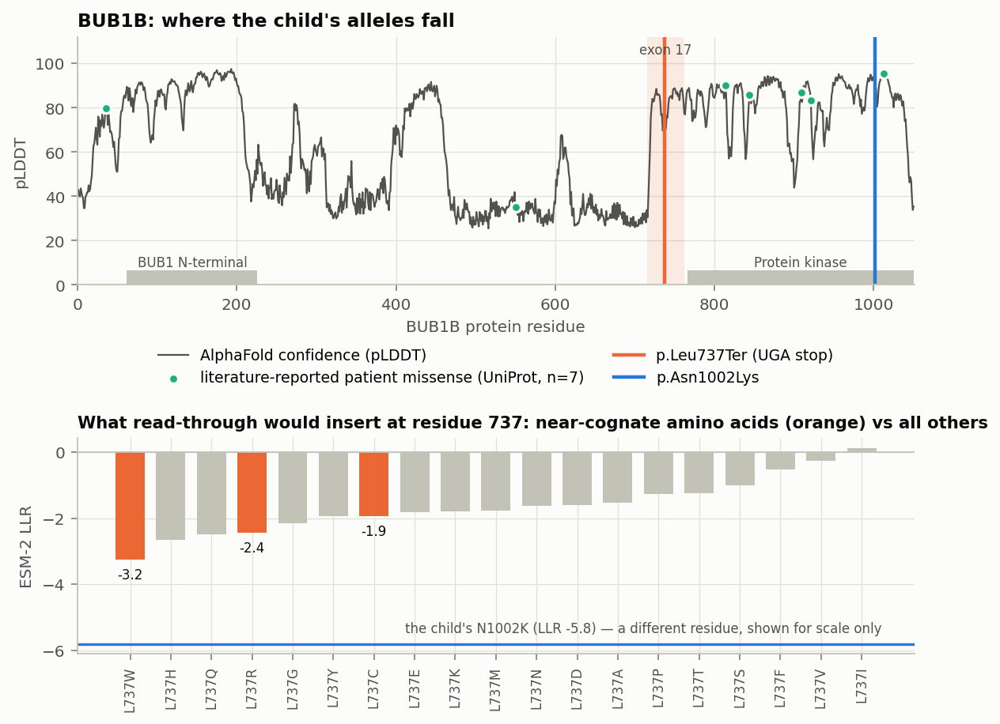

# rusheel86 — Track 2 report: from the BUB1B genotype to approved-drug hypotheses

*Generated automatically by the analysis notebook on 2026-10-24. Hypotheses for follow-up, not evidence that any medicine works; nothing here is medical advice, and no agent named here is proposed for use in this child. Every candidate below is a laboratory question to be answered in patient-derived cells first.*

> **Thesis.** When no approved drug fits the protein, treat the *alleles*. This child's two BUB1B alleles — a premature stop and a destabilising missense — each have a distinct, approved-drug lever, and a single experiment in the child's own cultured cells tests both levers while also supplying the evidence that would firm up the diagnosis.

## What is new here

Conventional drug repurposing asks which drug acts on the protein a gene makes. For a loss-of-function disorder that question often has no answer, and section 5 shows it returning none here. This report asks a different question — what can still be done with each *allele* — and makes it computable:

* an allele-level triage that reads the stop codon, the decay prediction, the amino acids read-through would insert, the exon's frame and the predicted structure, and assigns each allele a lever; it is gene-agnostic and runs from public data alone;
* a protein language model used not to score the variant the child has, but to score the residues a drug would *introduce*, which is what decides whether read-through is worth attempting;
* one RT-PCR amplicon, designed automatically with the primers printed in section 2, that answers the phase question, the decay question and the drug question from the same cells;
* allele-resolved peptides whose masses differ, so the protein made by each copy of the gene can be measured separately rather than inferred;
* the same triage run across every catalogued disease-causing allele in the disorder's gene panel, so the answer for this child indexes the other children it would apply to.

## At a glance

| | Allele 1 | Allele 2 |
|---|---|---|
| What it is | p.Leu737Ter — premature stop | p.Asn1002Lys — missense |
| What it does to the protein | little or no protein from this copy (mRNA predicted to decay by NMD) | protein made, but less stable or less active |
| The lever | restore protein from this copy: read-through, and relief of NMD | raise the abundance of what this copy makes — if the change acts by destabilising the protein rather than by disrupting an interaction surface, which the cell experiment decides |
| Approved agents to test (laboratory first) | azithromycin; amlexanox | niacin |

**One experiment answers both, and the diagnosis too.** The two alleles sit 10,911 bp apart in the genome but only 796 nt apart in the mRNA, so a single 1,302-nt RT-PCR amplicon from cultured cells (primers in section 2) reads both alleles on the same molecule — read on a long-read platform, or cloned so that individual molecules are Sanger-sequenced, because the two sites are too far apart for a single Sanger read to resolve them. It settles whether the alleles are in trans, measures how much of the stop allele's mRNA survives NMD, and with allele-resolved peptides measures the protein each allele makes under each drug. The same result supplies the evidence that would move the second allele out of 'uncertain significance' (section 7). Because the two levers act on different copies of the gene, the same cells can also test them together (a read-through agent with niacin), where the prediction is that their effects add.

**Two things here are usable without waiting for any experiment.** Section 6 lists the medicines and procedures that warrant extra care in a child who has both chromosomal instability and a cancer predisposition, each with its published reason — that is for the treating team, today. Section 7 shows how the same cell experiment that tests the drug hypotheses would also supply the evidence needed to reclassify the second allele, which is what turns a probable diagnosis into a firm one and opens carrier testing for the family. Neither depends on any medicine working.

**What this report does not claim.** That any of these agents should be given to this child, or that read-through delivers enough protein to help — that is the open question, and sections 1 and 2 state what would settle it and what would falsify each hypothesis.

## Summary

The child carries a nonsense allele (p.Leu737Ter) and a missense allele (p.Asn1002Lys) in BUB1B. No approved drug acts on the BUB1B network in a direction that would help (section 5), so we asked instead what can still be done with each allele. The nonsense allele creates a UGA stop, the stop codon most prone to drug-induced read-through; its mRNA is predicted to be removed by nonsense-mediated decay (NMD). 

Two approved medicines act on that allele by different routes: **azithromycin**, which in a reporter assay stimulated read-through specifically at UGA stops — the class this allele belongs to — and which, in mice carrying a germline nonsense allele of a tumour-suppressor gene, restored the full-length protein and prevented tumours (Semba R et al. 2023, *Biomed Pharmacother* (PMID 37276642); Dabrowski M et al. 2021, *Int J Mol Sci* (PMID 34066907)); and **amlexanox**, which both relieves NMD and induces read-through, and restored full-length protein from the nonsense allele of a missense + nonsense genotype in another gene, though in a heterologous expression system (Banning A et al. 2018, *Biochim Biophys Acta Mol Basis Dis* (PMID 29247835)). ESM-2 scores the amino acids that read-through would insert at residue 737 (L737W LLR -3.2, L737C LLR -1.9, L737R LLR -2.4); these are comparable with one another at this residue, not with scores elsewhere in the protein. 

If NMD alone is relieved, a fragment of 736 native residues would remain. That includes everything in a truncation published to support the checkpoint (Suijkerbuijk SJ et al. 2010, *Cancer Res* (PMID 20516114)); whether it is stable, functional, or instead sequesters its binding partners is untested, and section 2 sets out how to find out. 

These predictions can be tested in the child's own cells in one experiment (section 2): one RT-PCR amplicon spanning both alleles phases them and measures how much nonsense-allele mRNA escapes NMD; allele-resolved peptides measure the protein each allele makes. The same triage over the 131 ClinVar P/LP alleles in the 6 genes of the disorder's panel that have any catalogued alleles shows how many other catalogued alleles share each lever (section 7), and it runs unchanged for any gene.

**Method in brief.** (1) *Allele-level triage* — computed for each allele from the reference sequence, the MANE gene model, ESM-2 and the AlphaFold model; (2) *literature layer* — graded hypotheses whose every citation is resolved live; (3) *automated network pass* over Open Targets with direction gates; (4) *scalability* — the triage repeated over every ClinVar P/LP allele in the disorder's gene panel. Grades: A human trial in a relevant population · B in vivo evidence in the same gene defect (the intervention may be genetic rather than the drug itself) · C human patient cells or trials in another disease with the same molecular lesion · D mechanistic inference · X direction of effect uncertain.

## 1. Mechanism of the variants

*The genotype this report builds on came from five independent runs of this pipeline on the child's data, on three kinds of machine (a dual-GPU machine, a TPU host and a plain four-CPU machine) and with two different population-frequency sources, the second used when a download of the first failed. The top-ranked genotype and its coordinates were identical in every run. The lower-ranked alternatives within the same gene did change between runs (three to five rows), so only the top-ranked pair is relied on here. This is a statement about repeat runs of this pipeline, not an independent confirmation of the diagnosis, and it is recorded because the rest of this report rests on it.*

* `p.Leu737Ter` (Likely pathogenic): null allele — nonsense-mediated decay predicted, no protein from this copy.
* `p.Asn1002Lys` (Uncertain significance): missense — hypomorphic candidate: protein made but expected to be less stable or less active.

**Loss of function with residual activity.** BUBR1 is the pseudokinase core of the mitotic checkpoint complex that holds APC/C-CDC20 until every kinetochore is attached, and it recruits PP2A-B56 to stabilise correct attachments (Suijkerbuijk SJ et al. 2012, *Dev Cell* (PMID 22698286); Suijkerbuijk SJ et al. 2012, *Dev Cell* (PMID 23079597)). Complete loss is cell-lethal (Kops GJ et al. 2004, *Proc Natl Acad Sci U S A* (PMID 15159543)), so affected children carry one null allele plus one allele with residual function (Hanks S et al. 2004, *Nat Genet* (PMID 15475955)); in a graded knockdown of a human cell line, premature chromatid separation rose first and aneuploidy appeared only below about 50 % of normal BUBR1 (Bohers E et al. 2008, *Hum Genet* (PMID 18932004)). **The therapeutic lever is therefore a modest, proportional increase in residual BUBR1**; full rescue is neither expected nor required.

**How much would be enough?** This question decides whether a weak intervention is worth testing at all. A graded knockdown in a human cell line — not patient cells — gives a dose-response rather than a threshold: premature chromatid separation rose first, and aneuploidy appeared only below about half of normal BUBR1 (Bohers E et al. 2008, *Hum Genet* (PMID 18932004)). Mice engineered to express only low amounts of BUBR1 are viable and reproduce much of the MVA spectrum (Baker DJ et al. 2004, *Nat Genet* (PMID 15208629)), and combining different mutant alleles showed that which alleles are present changes severity beyond the total protein level alone (Sieben CJ et al. 2020, *J Clin Invest* (PMID 31738183)). Read-through typically restores only a low single-digit percentage of a protein, and that is from one allele. **We do not claim that this is enough: the gap between what read-through delivers and what this genotype needs is the central unresolved question of this report, and we have found no data that closes it for BUB1B.** What can be done is to measure that gap rather than argue about it, which is the purpose of the gentamicin arm: as the most potent read-through agent available it sets the ceiling for how much protein this particular allele can yield, turning an open question into a number before any clinical question is raised. If that ceiling sits far below the level at which premature chromatid separation improves, the stop-codon hypotheses should be abandoned and the missense allele's abundance is the remaining lever.

**Two allele classes, one of each here.** In patient cells, MVA alleles fall into two classes (Suijkerbuijk SJ et al. 2010, *Cancer Res* (PMID 20516114)): truncating alleles whose transcripts are absent (NMD), and missense alleles in or near the kinase domain that lower BUBR1 through faster protein turnover. The same study showed that a truncated BUBR1 lacking the kinase domain (731X, 715 BUBR1 residues) still supports the checkpoint and stable microtubule attachments when expressed from a cDNA (no NMD), whereas a slightly longer truncation (753X) was expressed at lower levels, which the authors note need not mean reduced stability. The child's missense change lies in the Protein kinase (766-1050) (AlphaFold pLDDT 91.1), 12.3 Å from the reported MVA1 allele L1012P; it is less buried than 62 % of the domain's residues, so a surface or interface effect is as plausible as unfolding. Whether it acts like the published kinase-domain alleles (low abundance through faster turnover) or through a functional defect is the first question the cell experiment answers (cycloheximide chase, section 2).

| Consequence of BUBR1 insufficiency | Child's feature it plausibly explains | Evidence |
|---|---|---|
| chromosome missegregation → variegated aneuploidy | the diagnosis | Hanks S et al. 2004, *Nat Genet* (PMID 15475955) |
| cancer predisposition (Wilms tumour, rhabdomyosarcoma, haematological) | rhabdomyosarcoma | Kajii T et al. 2001, *Am J Med Genet* (PMID 11746029); Nakano Y et al. 2024, *Clin Cancer Res* (PMID 39264246) |
| p16-driven senescence, progeroid 'cachectic dwarfism' in hypomorphic mice | small for gestational age, short stature, failure to thrive, muscle atrophy | Baker DJ et al. 2004, *Nat Genet* (PMID 15208629); Baker DJ et al. 2008, *Nat Cell Biol* (PMID 18516091) |
| carrier parents show intermediate premature chromatid separation (method-dependent) | family counselling: whether carrier parents have any reproductive phenotype is **unproven** — one unreplicated 2026 report of BUB1B variants in recurrent pregnancy loss, and a negative screen of aneuploid miscarriages | Kajii T et al. 2001, *Am J Med Genet* (PMID 11746029); Ikeuchi T et al. 2004, *Am J Med Genet A* (PMID 15108198); Wei TY et al. 2026, *Front Endocrinol (Lausanne)* (PMID 42434306); Gorji R et al. 2025, *Mol Biol Res Commun* (PMID 40028477) |
| — (not explained by the checkpoint model) | nephrocalcinosis: prematurity and renal tubulopathies are more parsimonious | see the nephrocalcinosis hypothesis in section 3 |

## 2. Allele-level therapeutic triage (computed)

Drug-target databases ask which drug acts on a protein near the gene. For a loss-of-function disorder the more useful question is what can still be done with each allele; this section answers it from sequence, gene model, protein language model and predicted structure. The code is gene-agnostic.

**Nonsense allele p.Leu737Ter**

| Property | Value | What follows |
|---|---|---|
| stop codon / next nucleotide | UGA, followed by A; UGA ranks first of the three stop codons for read-through (UGA > UAG > UAA) | UGA is the most read-through-prone stop in reporter assays (Howard MT et al. 2000, *Ann Neurol* (PMID 10939566)); a +4 C enhances read-through, while stop identity alone did not change the gentamicin response in another study (Floquet C et al. 2012, *PLoS Genet* (PMID 22479203)), and in Duchenne patients neither predicted response (Malik V et al. 2010, *Ann Neurol* (PMID 20517938)): measure, do not infer |
| nonsense-mediated decay | predicted | exon 17 of 23; NMD removes the template for read-through, hence the value of a dual NMD-inhibitor / read-through drug |
| what read-through would insert | L737W: LLR -3.2, L737C: LLR -1.9, L737R: LLR -2.4 | near-cognate tRNAs insert Trp, Cys, Arg at UGA (Roy B et al. 2016, *Proc Natl Acad Sci U S A* (PMID 27702906)). Every substitution the triage scores at residue 737 lands in a narrow band, which says the position is weakly constrained rather than that any particular insertion would work; these scores are comparable with each other at this residue, but not with scores at a different residue, so the child's own N1002K (LLR -5.8) is given for scale only and not as a benchmark |
| structure at the stop residue | AlphaFold pLDDT 73.6 |  |
| truncated product if NMD is relieved | residues 1-736 (~83.1 kDa); keeps BUB1 N-terminal (62-226); Necessary for interaction with KNL1 (152-185); Disordered (368-393); Disordered (456-480); loses Protein kinase (766-1050) | the truncated product keeps 736 native residues, all 715 of a truncation that still supported the checkpoint (731X; the authors note it 'contains only 715 amino acids of BUBR1 sequence', so its last residues are not native), plus 21 more; another truncation (753X) was expressed only weakly, so the stability of this one is an open question (Suijkerbuijk SJ et al. 2010, *Cancer Res* (PMID 20516114)). A stable fragment that keeps the CDC20-, BUB3- and PP2A-B56-binding motifs but lacks the pseudokinase could also sequester those partners (a dominant-negative risk), which the cell assay must exclude |
| antisense exon skipping | exon 17: 141 nt (in frame), spanning residues 715-762 (the codons at each boundary are split across neighbouring exons), mean pLDDT 78.5; natural isoform skipping it: none annotated | lower priority: the exon's residues are structured |

**Missense allele p.Asn1002Lys** — Protein kinase (766-1050); AlphaFold pLDDT 91.1; ESM-2 LLR -5.81; less buried than 62 % of the domain's residues; nearest literature-reported patient missense: L1012P (MVA1, 12.3 Å), I909T (MVA1, 24.4 Å), L844F (MVA1, 25.7 Å). No approved drug binds this domain: BUBR1 is a pseudokinase (Suijkerbuijk SJ et al. 2012, *Dev Cell* (PMID 22698286)) whose kinase domain bound no nucleotide in a pseudokinase thermal-shift survey (Murphy JM et al. 2014, *Biochem J* (PMID 24107129)), so a small-molecule chaperone is not available; the lever is protein abundance (the missense-allele lead, hypothesis 3).

### One experiment in the child's own cells tests every lever

* **Phase and NMD from one RT-PCR.** The alleles are 10,911 bp apart in the genome — too far for short reads — but 796 nt apart in the mRNA (13.7× closer). One amplicon of ~1,302 nt from cultured cells, with and without an NMD inhibitor as is standard in RNA diagnostics (Buisine MP et al. 2025, *Eur J Hum Genet* (PMID 40473777)), shows whether the alleles are in trans and how much nonsense-allele mRNA survives NMD. The two sites are 796 nt apart within the amplicon, which is beyond one Sanger read, so the single-molecule readout is long-read sequencing of the amplicon or Sanger sequencing of individual clones; RNA-based phasing of distant variants is established in principle (Castel SE et al. 2016, *Nat Commun* (PMID 27605262)); parental testing remains the clinical standard (Richards S et al. 2015, *Genet Med* (PMID 25741868)).
  Primer3 pair, ready to order: forward `ATCCTGAGAGACTGTTACCGGA` (exon 15, Tm 60.0 °C), reverse `ATACAACCATTGCTCTGAGGCA` (exon 23, Tm 60.0 °C); 1,302-nt product with the two sites at positions 310 and 1106. Genomic DNA would give a 14,459-bp product, beyond a standard extension time. No variant of the child and no common SNP (MAF ≥ 1 %) lies under either primer, so neither allele should drop out and bias the allelic ratio. Reads carrying the stop allele with the reference missense base (and vice versa) prove trans; 2 alternative pair(s) are in the notebook output.
* **Allele-resolved peptides.** If the alleles are in trans, a read-through product of the nonsense allele carries a near-cognate amino acid at the stop residue and the reference residue at the missense site, which no other product can carry because the truncated product ends before it. Each peptide below is digested from the protein that allele actually makes and differs in mass from the others, so targeted mass spectrometry measures read-through directly, separately from the missense allele's protein:

| Protease | Form | Peptide | Monoisotopic mass (Da) | Made by |
|---|---|---|---|---|
| Glu-C | N1002 (reference) | `LWNKFFVRILNANDE` | 1877.979 | the stop allele — only by read-through, since the truncated product ends before this residue |
| Glu-C | N1002K | `LWNKFFVRILKANDE` | 1892.031 | the missense allele |
| Lys-C | L737 (reference) | `SLPELSASAELCIEDRPMPK` | 2185.076 | the missense allele |
| Lys-C | L737W | `SLPEWSASAELCIEDRPMPK` | 2258.071 | read-through of the stop allele inserting W |
| Lys-C | L737C | `SLPECSASAELCIEDRPMPK` | 2175.001 | read-through of the stop allele inserting C |
| Lys-C | L737R | `SLPERSASAELCIEDRPMPK` | 2228.093 | read-through of the stop allele inserting R |

**Pre-registered predictions**

| Arm | Readout | Pre-registered prediction if the lever works |
|---|---|---|
| baseline (untreated cells ± puromycin / cycloheximide) | RT-PCR amplicon (1,302 nt) | two allele-specific molecule classes if the alleles are in trans; the nonsense-allele fraction rises when NMD is blocked |
| azithromycin; amlexanox, dose series | allelic ratio on the same amplicon | nonsense-allele mRNA fraction rises |
| azithromycin; amlexanox; gentamicin (positive control) | allele-resolved peptides (section 2) | read-through peptides appear only with drug; so does the reference missense-site peptide, which only a full-length product of the stop allele can carry |
| azithromycin; amlexanox | immunoblot, N-terminal BUBR1 antibody | a ~83 kDa fragment (residues 1-736) if NMD is relieved and the fragment is stable |
| niacin (nicotinamide as comparator) | BUBR1 half-life (cycloheximide chase), K668 acetylation | longer half-life; more BUBR1 protein; no growth advantage for the aneuploid fraction |
| azithromycin + niacin together (both copies at once) | total BUBR1 (immunoblot), premature chromatid separation | the effects add, because each drug acts on a different copy; if they do not, one of the two levers is not working |
| every arm vs untreated and parental cells | nocodazole arrest, premature chromatid separation, micronuclei | move toward parental values; no worsening of segregation (TBK1 inhibition by amlexanox is the specific risk) |

**What would falsify each hypothesis.** Stated before the experiment so the result cannot be reinterpreted afterwards:

* *No read-through peptide and no full-length protein in the gentamicin arm* → this allele is not read-through-competent, and the stop-codon hypotheses (1, 2 and 4) are dead, whatever the mRNA does.
* *No read-through above the assay's limit of quantitation* — which must be fixed first, from a dilution series of synthetic peptide spiked into untreated lysate, so that 'none detected' means a number rather than an impression. *Read-through detectable with gentamicin but the ceiling it reaches is far below the level at which premature chromatid separation improves* → the approach cannot work for this genotype at achievable exposures; report the ceiling and stop.
* *Nonsense-allele mRNA does not rise when NMD is blocked* → the NMD premise is wrong and hypothesis 2 loses its rationale.
* *The truncated fragment is stable but segregation worsens* → the dominant-negative risk above is real, and relieving NMD is harmful rather than helpful.
* *No increase in BUBR1 half-life or abundance with niacin* → the NAD+/SIRT2 hypothesis (3) is dead for this missense allele.
* *The amplicon shows the alleles in cis* → the compound-heterozygous model is wrong, and every allele-level hypothesis here is void.

**Feasibility.** The whole panel runs on cultured skin fibroblasts or a lymphoblastoid line from one biopsy or blood draw that a diagnostic laboratory can already obtain; the readouts (RT-PCR read on a long-read platform or cloned and Sanger-sequenced, two immunoblots, targeted mass spectrometry, and standard cytogenetic scoring of premature chromatid separation and micronuclei) are routine, need no new reagents beyond the primers printed above, and would report in weeks rather than years. Nothing here requires the child to take anything.

## 3. Ranked hypotheses

| # | Lever | Hypothesis | Grade |
|---|---|---|---|
| 1 | stop allele: read-through | Read-through of the nonsense allele with an approved macrolide, tested first in patient-derived cells | C / C |
| 2 | stop allele: NMD inhibition + read-through | Rescue protein from the nonsense allele with a dual NMD-inhibitor / read-through drug | C / D |
| 3 | missense allele / pathway: BUBR1 stability | NAD+ augmentation to raise residual BUBR1 via SIRT2 | B / X |
| 4 | stop allele: laboratory benchmark only (an assay control, not a candidate) | Aminoglycoside read-through as the ex-vivo benchmark - NOT proposed for use in this child | C / X |
| 5 | symptom: nephrocalcinosis | Cause-directed treatment of nephrocalcinosis after a tubular work-up | A (indication) / D (MVA-specific) |

### 1. Read-through of the nonsense allele with an approved macrolide, tested first in patient-derived cells — grade C / C

* **Lever.** stop allele: read-through
* **Agent(s).** azithromycin (approved worldwide; decades of long-term paediatric use in cystic fibrosis, primary ciliary dyskinesia and bronchiectasis; oral, no nephro- or ototoxicity of the aminoglycoside kind, and it accumulates to high intracellular concentrations - the exposure argument the other read-through agents lack)
* **Rationale.** In a reporter assay across six premature stop codons from primary ciliary dyskinesia patients, azithromycin stimulated read-through only at the UGA codons - the class this child's stop allele belongs to - and the effect was modest; in mice carrying a germline nonsense allele of the tumour-suppressor Apc it read through that allele, restored full-length Apc, lowered beta-catenin / cyclin D1 and prevented intestinal tumour formation. That is the closest precedent we identified for read-through acting as cancer prevention in a germline nonsense cancer-predisposition genotype, which is the architecture of this child's stop allele
* **Main caveat.** The grade is C, not B, because the in vivo evidence is in another gene: this report reserves B for in vivo data in the same gene defect. In that same reporter study azithromycin was less efficient than aminoglycosides, and at the two non-UGA stop codons it REDUCED read-through by more than half, so the effect is codon-specific rather than general; the most responsive reporters had a UGA followed by cytosine, whereas this child's UGA is followed by adenine, a less favourable context; viability of primary nasal epithelial cells was preserved, but azithromycin was among the compounds that caused a small, statistically significant fall in ciliary beat frequency (remaining within the normal range), whereas amlexanox and gentamicin caused none; the Apc work is a mouse tumour-prevention study in another gene, given in drinking water, where the LOWEST dose was the most effective (a non-monotonic dose-response) and the authors themselves raise a microbiome confound; read-through of BUB1B has never been tested; macrolides carry QT prolongation, antimicrobial-resistance and (with long exposure) hearing-loss concerns, so this is a laboratory hypothesis, not a proposal to treat
* **How it would be tested.** Patient-derived fibroblasts or LCLs: allelic ratio on the cDNA amplicon, N- and C-terminal BUBR1 immunoblots, allele-resolved peptides, nocodazole arrest, premature chromatid separation, micronuclei
* **References.** Semba R et al. 2023, *Biomed Pharmacother* (PMID 37276642), Semba R et al. 2023, *Biomed Pharmacother* (PMID 37385919), Dabrowski M et al. 2021, *Int J Mol Sci* (PMID 34066907), Thrasher K et al. 2026, *J Cyst Fibros* (PMID 41015699)

### 2. Rescue protein from the nonsense allele with a dual NMD-inhibitor / read-through drug — grade C / D

* **Lever.** stop allele: NMD inhibition + read-through
* **Agent(s).** amlexanox (oral tablet long marketed in Japan for asthma / allergic rhinitis - current marketing status not verifiable from public regulatory records, so availability is not an argument here; the US topical paste was discontinued in 2017; oral dosing was also tested in a 42-patient randomised trial in adults with type 2 diabetes, which shows oral tolerability only)
* **Rationale.** The nonsense allele's mRNA is predicted to be degraded by NMD, as MVA truncating-allele transcripts are absent in patient cells; amlexanox stabilises NMD-prone mRNAs and induces read-through, and for a compound-heterozygous missense / nonsense patient genotype (another gene, aspartylglucosaminuria) it restored full-length protein from the nonsense allele with a synergistic gain in activity - the same architecture as this child's pair. Two products could result: full-length BUBR1 carrying a near-cognate amino acid at the stop, and - where only NMD is relieved - the N-terminal fragment. A truncated BUBR1 of 715 BUBR1 residues (731X) still supported the checkpoint and stable attachments, whereas another truncation (753X) was expressed only weakly, which the authors note need not mean reduced stability, so whether this fragment is stable, functional, or instead sequesters CDC20 / BUB3 / PP2A-B56 as a dominant negative is an open, testable question
* **Main caveat.** That rescue was measured in a heterologous expression system, not in patient primary cells; whether the concentrations that worked in cells are reachable in a person is the gating question and we leave it open rather than guess - amlexanox acted at 5-25 micromolar in the studies that reported the lowest effective concentrations, and at 25-125 micromolar in others, so roughly 1.5-37 microgram/mL for its molecular weight of 298.3, and we found no peer-reviewed human oral pharmacokinetic study reporting a plasma Cmax to compare it against (the only quantitative pharmacokinetic data we could verify are from a dog study), so no fold-difference is claimed here and human exposure data would have to be obtained before any systemic route could be argued at all; it was also less efficient than aminoglycosides in a head-to-head reporter comparison; it inhibits TBK1 / IKK-epsilon and TBK1 has mitotic functions, so the net effect on segregation must be measured; and sustained NMD inhibition itself raises R-loops and DNA damage, which is an unattractive trade in a chromosomal-instability cancer-predisposition syndrome
* **How it would be tested.** Patient-derived fibroblasts or LCLs: allelic ratio on the cDNA amplicon, N- and C-terminal BUBR1 immunoblots, allele-resolved peptides, nocodazole arrest, premature chromatid separation, micronuclei
* **References.** Gonzalez-Hilarion S et al. 2012, *Orphanet J Rare Dis* (PMID 22938201), Banning A et al. 2018, *Biochim Biophys Acta Mol Basis Dis* (PMID 29247835), Benslimane N et al. 2023, *Pharmaceuticals (Basel)* (PMID 37513945), Suijkerbuijk SJ et al. 2010, *Cancer Res* (PMID 20516114), Roy B et al. 2016, *Proc Natl Acad Sci U S A* (PMID 27702906), Pillai S et al. 2015, *Nat Commun* (PMID 26656453), Oral EA et al. 2017, *Cell Metab* (PMID 28683283), Yi Y et al. 2026, *Biomed Chromatogr* (PMID 42788676), Dabrowski M et al. 2021, *Int J Mol Sci* (PMID 34066907), Pastrana CC et al. 2026, *Cancer Res* (PMID 41954618)

### 3. NAD+ augmentation to raise residual BUBR1 via SIRT2 — grade B / X

* **Lever.** missense allele / pathway: BUBR1 stability
* **Agent(s).** niacin (nicotinic acid; raises NAD+ by the Preiss-Handler route and does not product-inhibit sirtuins); nicotinamide as the comparator arm (long-term exposure is documented at 1.2 g/m2/day for five years in a diabetes-prevention trial whose participants were relatives aged 3-40, so it included children and growth was unaffected); nicotinamide riboside / NMN are supplements and outside scope
* **Rationale.** MVA missense alleles in or near the kinase domain lower BUBR1 through faster protein turnover; SIRT2 keeps BUBR1-K668 deacetylated and stable; NMN raised BubR1 in vivo and SIRT2 extended median lifespan of BubR1-hypomorphic mice. Niacin corrected systemic NAD+ deficiency and improved muscle performance in adults with mitochondrial myopathy, which is why it is the probe of choice here
* **Main caveat.** The in vivo support is a genetic manipulation (SIRT2 overexpression), not the drug - the same limitation for which senolytics are set aside below, and the reason this is graded B/X rather than higher; nicotinamide is itself a sirtuin product-inhibitor, so the net effect on SIRT2 activity is unproven and niacin is the cleaner probe; correcting an NAD+ deficiency does not guarantee clinical benefit - in a child with mitochondrial myopathy and NAD+ deficiency, niacin produced a metabolic response but did not halt the disease, which is the honest ceiling on this kind of hypothesis; the cancer data are not reassuring so much as absent (nicotinamide reduced keratinocyte cancers in one randomised trial but not in a second, and an NAD+ precursor suppressed liver-cancer growth in mice; none of these studies involved chromosomal instability or rhabdomyosarcoma), so an effect on tumour metabolism cannot be excluded and must be measured in the child's own cells before anything else
* **How it would be tested.** Patient-derived cells: BUBR1 protein and half-life (cycloheximide chase), K668 acetylation, mitotic timing, micronuclei, and proliferation of the aneuploid fraction, with and without niacin / NAM
* **References.** Suijkerbuijk SJ et al. 2010, *Cancer Res* (PMID 20516114), North BJ et al. 2014, *EMBO J* (PMID 24825348), Pun R et al. 2024, *Semin Cancer Biol* (PMID 39490401), Chen AC et al. 2015, *N Engl J Med* (PMID 26488693), Allen NC et al. 2023, *N Engl J Med* (PMID 36856616), Bitterman KJ et al. 2002, *J Biol Chem* (PMID 12297502), Suaste V et al. 2026, *Int J Mol Sci* (PMID 42449929), Pirinen E et al. 2020, *Cell Metab* (PMID 32386566), Aaltio J et al. 2024, *Neuromuscul Disord* (PMID 39173541), Gale EA et al. 2004, *Lancet* (PMID 15043959), Pang N et al. 2023, *Nutrients* (PMID 36986177)

### 4. Aminoglycoside read-through as the ex-vivo benchmark - NOT proposed for use in this child — grade C / X

* **Lever.** stop allele: laboratory benchmark only (an assay control, not a candidate)
* **Agent(s).** gentamicin (laboratory positive control in cultured patient-derived cells only)
* **Rationale.** UGA is the most read-through-prone stop in reporter assays and read-through inserts Trp, Cys or Arg there; aminoglycosides are the most potent read-through agents available, so gentamicin establishes whether this particular allele is read-through-competent at all and calibrates how much protein the approved agents above could ever deliver
* **Main caveat.** Systemic use is excluded here, not merely cautioned: gentamicin is nephrotoxic (acute kidney injury in 20-33 % of exposed children) and irreversibly ototoxic, the i.v. read-through trials excluded pre-existing renal impairment, and this child has nephrocalcinosis; in Duchenne patients neither the stop codon nor the +4 nucleotide predicted response and one read-through epitope was immunogenic - response must be measured, not inferred
* **How it would be tested.** Same cultured-cell assays as #1 and #2, as the positive control that shows whether this allele is read-through-competent
* **References.** Howard MT et al. 2000, *Ann Neurol* (PMID 10939566), Floquet C et al. 2012, *PLoS Genet* (PMID 22479203), Roy B et al. 2016, *Proc Natl Acad Sci U S A* (PMID 27702906), Mosallaei D et al. 2022, *JAMA Dermatol* (PMID 35234826), Woodley DT et al. 2024, *Br J Dermatol* (PMID 38366625), Woodley DT et al. 2017, *J Clin Invest* (PMID 28691931), Malik V et al. 2010, *Ann Neurol* (PMID 20517938), McWilliam SJ et al. 2017, *Pediatr Nephrol* (PMID 27848094), Karri S et al. 2024, *J Cyst Fibros* (PMID 39098506)

### 5. Cause-directed treatment of nephrocalcinosis after a tubular work-up — grade A (indication) / D (MVA-specific)

* **Lever.** symptom: nephrocalcinosis
* **Agent(s).** thiazide (hypercalciuria); potassium citrate / alkali (distal RTA, hypocitraturia)
* **Rationale.** Independent of BUBR1: prematurity and renal tubulopathies explain most paediatric nephrocalcinosis; part of the failure to thrive may be renal and correctable; the closest paediatric interventional evidence is indirect - in 11 children with X-linked hypophosphataemia whose nephrocalcinosis was caused by their phosphate and vitamin D treatment, a thiazide was followed by no radiological progression, in an uncontrolled before-and-after comparison
* **Main caveat.** Drug choice depends on urine calcium, citrate, oxalate, pH and serum bicarbonate; this is a work-up recommendation for the treating nephrologist, not a drug proposal, and prescribing blind could harm
* **How it would be tested.** Standard nephrology work-up; renal function follow-up
* **References.** Ayoub EAM et al. 2026, *J Bras Nefrol* (PMID 41615714), İnözü M et al. 2026, *Front Pediatr* (PMID 41867929), Zheng J et al. 2025, *Front Pediatr* (PMID 41311422), Seikaly MG et al. 2001, *Pediatrics* (PMID 11433085)

## 4. Considered and set aside

| Option | Why it is not proposed |
|---|---|
| Ataluren (read-through) | EU conditional authorisation not renewed (European Commission decision, 28 March 2025) and never approved in the US; a UK licence is reported to have been retained for its Duchenne indication, so it is a geographically restricted comparator rather than a candidate. It does act on the mechanism of interest - it promotes insertion of near-cognate tRNAs at premature stops - but availability, not mechanism, is what rules it out here (PMID 27702906) |
| Hydroxychloroquine (aneuploidy-selective chemoprevention) | the screen compound was chloroquine, not hydroxychloroquine; in mosaic variegated aneuploidy the aneuploid cells are largely normal tissue, so selecting against them could worsen growth failure, and the aneuploidy-vulnerability field has moved on (PMID 21315436, 28775166, 40054068) |
| Metformin (senescence / inflammation) | the aneuploidy-selective energy-stress compound in the original screen was AICAR (not approved), not metformin; and at millimolar concentrations in vitro, under low glucose, metformin itself induced genotoxic stress (micronuclei, nucleoplasmic bridges) - a direction worth avoiding in a chromosomal-instability syndrome, even though the same study found it non-genotoxic in high glucose (PMID 18516091, 22048312, 21315436, 35568294) |
| ATP-site kinase inhibitors as pharmacological chaperones of the destabilised kinase domain | the human BUBR1 kinase domain bound no nucleotide in thermal-shift assays, so there is no pocket for such a ligand (PMID 24107129, 22698286) |
| Antisense skipping of the exon that carries the stop | assessed in the allele-level triage (frame, how structured the exon's residues are, natural isoforms); an n-of-1 ASO is not an approved drug (PMID 20516114) |
| Senolytic dasatinib + quercetin | p16-positive cell clearance in BubR1-hypomorphic mice was genetic (INK-ATTAC), not pharmacological; the dasatinib label warns about bone growth in children (short stature here) (PMID 22048312, 25754370) |

## 5. What the automated network pass found

144 nodes (the gene, its Open Targets interaction partners with score ≥ 0.7, and literature mechanism nodes); every drug / clinical candidate on them (Open Targets 26.9.0), gated by approval → direction (drug action × cited node sign) → antimitotic / genotoxic mechanism. BUB1B has 0 drugs acting on it directly (essential gene: True); 25 approved drug–target pairs on the network; by verdict: CAUTION: antimitotic / genotoxic mechanism: 18, indeterminate direction: 7. **No approved drug acts on the network in a direction predicted to raise residual function** — the classes that would (SIRT2 activation, partial APC/C-CDC20 inhibition) have no approved member. This honest negative is why the allele-level and literature layers exist.

The identical pass for the other genes of the indication panel:

| gene | network_nodes | drugs_on_gene | approved_rows | CAUTION: antimitotic / genotoxic mechanism | indeterminate direction |
|---|---|---|---|---|---|
| BUB1 | 146 | 0 | 33 | 26 | 7 |
| BUB3 | 78 | 0 | 17 | 0 | 17 |
| CENATAC | 4 | 0 | 0 | 0 | 0 |
| CEP57 | 5 | 0 | 0 | 0 | 0 |
| MAD1L1 | 50 | 0 | 9 | 0 | 9 |
| TRIP13 | 83 | 0 | 50 | 18 | 32 |

## 6. Caution list for the clinical team

| Medicine / class | Reason |
|---|---|
| Growth hormone | second-neoplasm risk (RR 1.77) in a cancer-predisposition syndrome with prior rhabdomyosarcoma; growth failure is cell-autonomous (PMID 35529328) |
| Vinca alkaloids / taxanes and other antimitotics | BubR1-insufficient cells slip through mitotic arrest; anticipate altered response and report outcomes - NOT a reason to withhold curative therapy (PMID 14744753, 16411201) |
| Topoisomerase-II poisons and other genotoxic agents | appear automatically as approved drugs on the network (above); genotoxic load in a chromosomal-instability syndrome warrants monitoring for secondary malignancy (PMID 31053147) |
| Ionising radiation for imaging | MVA surveillance guidance advises avoiding radiation exposure: ultrasound / MRI rather than CT where possible (PMID 39264246) |
| Systemic aminoglycosides | AKI in 20-33 % of exposed children; read-through trials excluded pre-existing renal impairment (PMID 27848094, 38366625) |
| Sustained systemic NMD inhibition | blocking nonsense-mediated decay raises R-loops and DNA damage and is being developed deliberately as a way to kill genomically unstable cells; relieving NMD is the point of the amlexanox hypothesis, so this trade-off must be measured in cells (micronuclei, DNA-damage markers) before any systemic use is ever contemplated in a chromosomal-instability syndrome (PMID 41954618, 42711693, 39667907) |
| HDAC inhibitors as mechanism-based therapy | opposite-signed acetylation sites on BUBR1 make the net effect indeterminate; mitotic histone deacetylation is required for accurate segregation (PMID 19407811, 24825348, 35922507) |
| Aurora B inhibitors | would remove the phosphorylation required for protective BUBR1-K250 acetylation (PMID 41533580) |
| Genotoxic conditioning / HSCT | the one published MVA1 transplant ended in graft rejection and death; MDS with monosomy 7 is a surveillance target (PMID 31053147) |

## 7. Impact

**For the diagnosis.** The weaker allele (p.Asn1002Lys) is classed uncertain significance by automated criteria. The evidence that would move it, on the point scale of Tavtigian SV et al. 2020, *Hum Mutat* (PMID 32720330):

| Step | Points | Posterior | Class |
|---|---|---|---|
| current automated evidence (phase unknown) | 3 | 0.500 | Uncertain significance |
| + PM3 confirmed in trans (partner allele Likely pathogenic; parental testing or the cDNA amplicon) | 4 | 0.675 | Uncertain significance |
| + PP4: phenotype highly specific for the gene's disorder (ClinGen caveats for heterogeneous disorders apply) | 5 | 0.812 | Uncertain significance |
| + PS3_moderate: allele-specific readout in the child's cells (peptides from this allele's protein; its half-life) shows reduced protein or function | 7 | 0.949 | Likely pathogenic |

Parental testing (or the cDNA amplicon above) supplies PM3, and the same cell experiment that tests the drugs supplies functional evidence: one experiment moves the diagnosis and the therapy question forward together. A firm diagnosis opens carrier testing for the parents and, if both carry one allele, a 25 % recurrence risk per pregnancy and the option of prenatal or preimplantation testing.

**Published MVA surveillance guidance, for the treating team's reference.** Consensus surveillance (Nakano Y et al. 2024, *Clin Cancer Res* (PMID 39264246)): renal ultrasound every 3 months until age 7; clinical review for signs of rhabdomyosarcoma, Wilms tumour and haematological malignancy; avoid ionising radiation; HPV vaccination. The nephrocalcinosis work-up (section 3) may uncover a treatable cause of part of the failure to thrive.

**For other children with the disorder.** The triage was repeated over all 131 ClinVar P/LP alleles in 6 of the panel's genes that have any catalogued alleles: read-through: UGA stop: 22, read-through: UAG / UAA stop: 27, exon skipping: lesion in an in-frame exon: 12, truncated protein escapes NMD: 2, missense: protein-level: 6, splice: splice-switching candidate: 21, start-loss: translation must restart downstream: 1, no allele-specific lever: 40. Nonsense alleles by stop codon: UGA 22, UAG 19, UAA 8 (in BUB1B: UAG 15, UGA 13, UAA 6). A positive cell result for the nonsense lever would therefore matter beyond this child.

**The number that matters for reach.** Of the 131 catalogued disease-causing alleles in this panel, 49 are premature stops and 22 of those are the same stop codon as this child's. Those are alleles, not people, and one person carries two; but every one of them is an allele for which this exact assay — the same primer logic, the same peptide design, the same readouts — would be built the same way. That is the sense in which a result here is not an n-of-1. 19 of the 131 have no assertion criteria in ClinVar; the review status is in the atlas file, so a stricter reading can simply filter them out.

| gene | read-through: UGA stop | read-through: UAG / UAA stop | exon skipping: lesion in an in-frame exon | truncated protein escapes NMD | missense: protein-level | splice: splice-switching candidate | start-loss: translation must restart downstream | no allele-specific lever | total |
|---|---|---|---|---|---|---|---|---|---|
| BUB1B | 13 | 21 | 6 | 0 | 1 | 11 | 0 | 34 | 86 |
| CEP57 | 5 | 2 | 4 | 1 | 0 | 4 | 1 | 3 | 20 |
| TRIP13 | 1 | 0 | 1 | 0 | 3 | 3 | 0 | 1 | 9 |
| MAD1L1 | 3 | 4 | 0 | 0 | 0 | 0 | 0 | 1 | 8 |
| BUB1 | 0 | 0 | 1 | 1 | 1 | 2 | 0 | 1 | 6 |
| CENATAC | 0 | 0 | 0 | 0 | 1 | 1 | 0 | 0 | 2 |

**What would have to happen next, and who could do it.** Nothing in this report changes anything today; it is a set of laboratory questions, and this is the shortest path from here to an answer:

1. *Confirm the genetics.* The treating clinical genetics service confirms both alleles and tests the parents, which settles phase by the standard route and is worth doing whatever happens with the rest.
2. *Grow the cells.* Skin fibroblasts or a lymphoblastoid line from the child, with a parental line alongside as the comparison. The challenge page says the MVA Society is funding focused research; whether banked patient cells already exist is for the family and the Society to say, and nothing here assumes it.
3. *Run the one amplicon.* Phase, NMD escape and the drug arms are all read out from the same cultured cells using the primers printed in section 2 — the cheapest experiment here and the one that can falsify the most.
4. *Report the answer either way.* Because mosaic variegated aneuploidy affects so few people, a negative result that retires a plausible idea is itself worth publishing; the atlas above names the other alleles to which the same answer would apply.

Each step uses assays a diagnostic or research laboratory already runs, which is the point: this is a protocol, not a programme.

**In plain language.** The child has two changes in the same gene, one inherited from each parent (which parental testing would confirm). One change stops the gene's instructions early, so that copy makes little or no protein. The other changes a single building block, so that copy probably makes protein that does not last as long or work as well. The protein's job is to check that chromosomes are shared out correctly when a cell divides, which is why cells in this condition end up with the wrong number of chromosomes. **No medicine is being recommended here, and nothing in this report should change anyone's current treatment.** What we have done is ask whether any already-approved medicine acts on either of those two specific problems, and then describe a laboratory test, done on cells grown from a small skin or blood sample, that would show whether any of them does anything useful — before anyone considers whether it could help a person. The same test would also help the laboratory decide, formally, whether the second change is disease-causing, which matters for the family's own genetic counselling. Questions a family might reasonably raise with their own care team are whether both parents have been tested, whether the recommended surveillance schedule is in place, and whether stored cells could be made available to researchers.

## 8. Does the triage get published answers right?

A classifier is only worth anything if it reproduces answers that are already known. The same triage was run, unchanged, over 16 premature-stop alleles in 6 genes outside this disorder's panel — alleles chosen because the published literature already reports how they behave when read-through is attempted. It recovered the published stop codon for 16 of 16 (100 %) directly from the reference sequence and the gene model, and assigned the matching lever class in 16 of 16.

| Lever assigned | UGA | UAG | UAA |
|---|---|---|---|
| read-through: UGA stop | 11 | 0 | 0 |
| read-through: UAG / UAA stop | 0 | 4 | 1 |

Recovering a stop codon from the reference sequence and the gene model is close to a sequence lookup, so a full score is the expected result rather than a finding about biology. What the check does establish is that the pipeline reads the reference, the gene model and the numbering correctly across genes and strands, and that its lever classes separate by stop codon as intended.

Two honest limits on what this shows. Every allele in the set is one where read-through has been reported to work to some degree, so the check measures whether the triage finds the alleles it should, not whether it rejects the ones it should — it tests sensitivity, not specificity. And one of the alleles contradicts the ordering the triage uses as a prior: a UAA allele responded better than UGA alleles tested alongside it. That is why the stop codon is treated here as a prior to be measured rather than a rule, and it is the clearest argument for running the laboratory arm before believing any ranking, including this report's own.

The per-allele table is saved as `lever_validation.csv`, with the published source for every entry.

## 9. Scalability

* The allele-level triage, the network pass and the report are produced by the notebook with no manual step, for whichever gene leads, from public resources only (MANE, GRCh38, ClinVar, ESM-2, AlphaFold DB, UniProt, Ensembl, Open Targets, Europe PMC); the triage took 1.7 min.
* In demo mode the same code runs on a public genome with a different spiked-in recessive gene, which is how it is tested.
* The atlas above is the same computation applied to a whole gene panel; it extends to any gene list. It is saved as `lever_atlas.csv` (one row per public ClinVar pathogenic / likely-pathogenic allele, with the lever, the reason for it, the stop codon, the exon and the ClinVar review status), so another group can point the same triage at their own gene list and get a comparable table without rerunning the patient-specific parts.

**Reproducibility.** Code: https://github.com/Rusheel86/MVA (CC BY 4.0, as required for submissions to this hackathon). `python build_nb.py` assembles the percent-format sources in `src/` into the notebook; running that notebook end to end reproduces every number, table and figure in this report, including this sentence, because the report is written by the pipeline rather than by hand. Without the gated dataset the same notebook runs in demo mode on a public genome with a different recessive gene spiked in, which is how each stage is tested; the run that produced this report took 70 minutes on a 4-CPU machine with no GPU.

## 10. Limitations

* No candidate has been tested in MVA; grades reflect indirect evidence. Amlexanox's cellular concentrations may not be reachable in plasma, its TBK1/IKKε inhibition could itself affect mitosis, and its oral form has been marketed in Japan, with its current status unverified.
* Read-through efficiency in patients is not predicted by the stop-codon context; ESM-2 scores of the inserted amino acids are predictions, not measurements, and read-through products can be immunogenic.
* Phase is inferred, not observed (see the Track 1 report); the allele-resolved readouts assume the alleles are in trans, which the cDNA amplicon tests first.
* Network drug lists depend on database coverage and on a small hand-curated sign map (printed in the notebook).
* Generative AI: Anthropic Claude Code (Claude Opus 5.5, Claude Opus 5 and Claude Sonnet 5.5), Claude Pro plan, was used to design and write this pipeline, and to draft the text that it renders into this report. Every literature claim was checked against the cited record before it was included. The model-training opt-out was enabled and no output ratings or feedback were submitted.

## References (resolved live from Europe PMC)

* Howard MT et al. 2000, *Ann Neurol* (PMID 10939566) — Sequence specificity of aminoglycoside-induced stop condon readthrough: potential implications for treatment of Duchenne muscular dystrophy.
* Seikaly MG et al. 2001, *Pediatrics* (PMID 11433085) — Thiazide diuretics arrest the progression of nephrocalcinosis in children with X-linked hypophosphatemia.
* Kajii T et al. 2001, *Am J Med Genet* (PMID 11746029) — Cancer-prone syndrome of mosaic variegated aneuploidy and total premature chromatid separation: report of five infants.
* Bitterman KJ et al. 2002, *J Biol Chem* (PMID 12297502) — Inhibition of silencing and accelerated aging by nicotinamide, a putative negative regulator of yeast sir2 and human SIRT1.
* Dai W et al. 2004, *Cancer Res* (PMID 14744753) — Slippage of mitotic arrest and enhanced tumor development in mice with BubR1 haploinsufficiency.
* Gale EA et al. 2004, *Lancet* (PMID 15043959) — European Nicotinamide Diabetes Intervention Trial (ENDIT): a randomised controlled trial of intervention before the onset of type 1 diabetes.
* Ikeuchi T et al. 2004, *Am J Med Genet A* (PMID 15108198) — Induction of premature chromatid separation (PCS) in individuals with PCS trait and in normal controls.
* Kops GJ et al. 2004, *Proc Natl Acad Sci U S A* (PMID 15159543) — Lethality to human cancer cells through massive chromosome loss by inhibition of the mitotic checkpoint.
* Baker DJ et al. 2004, *Nat Genet* (PMID 15208629) — BubR1 insufficiency causes early onset of aging-associated phenotypes and infertility in mice.
* Hanks S et al. 2004, *Nat Genet* (PMID 15475955) — Constitutional aneuploidy and cancer predisposition caused by biallelic mutations in BUB1B.
* Matsuura S et al. 2006, *Am J Med Genet A* (PMID 16411201) — Monoallelic BUB1B mutations and defective mitotic-spindle checkpoint in seven families with premature chromatid separation (PCS) syndrome.
* Baker DJ et al. 2008, *Nat Cell Biol* (PMID 18516091) — Opposing roles for p16Ink4a and p19Arf in senescence and ageing caused by BubR1 insufficiency.
* Bohers E et al. 2008, *Hum Genet* (PMID 18932004) — Gradual reduction of BUBR1 protein levels results in premature sister-chromatid separation then in aneuploidy.
* Choi E et al. 2009, *EMBO J* (PMID 19407811) — BubR1 acetylation at prometaphase is required for modulating APC/C activity and timing of mitosis.
* Suijkerbuijk SJ et al. 2010, *Cancer Res* (PMID 20516114) — Molecular causes for BUBR1 dysfunction in the human cancer predisposition syndrome mosaic variegated aneuploidy.
* Malik V et al. 2010, *Ann Neurol* (PMID 20517938) — Gentamicin-induced readthrough of stop codons in Duchenne muscular dystrophy.
* Tang YC et al. 2011, *Cell* (PMID 21315436) — Identification of aneuploidy-selective antiproliferation compounds.
* Baker DJ et al. 2011, *Nature* (PMID 22048312) — Clearance of p16Ink4a-positive senescent cells delays ageing-associated disorders.
* Floquet C et al. 2012, *PLoS Genet* (PMID 22479203) — Statistical analysis of readthrough levels for nonsense mutations in mammalian cells reveals a major determinant of response to gentamicin.
* Suijkerbuijk SJ et al. 2012, *Dev Cell* (PMID 22698286) — The vertebrate mitotic checkpoint protein BUBR1 is an unusual pseudokinase.
* Gonzalez-Hilarion S et al. 2012, *Orphanet J Rare Dis* (PMID 22938201) — Rescue of nonsense mutations by amlexanox in human cells.
* Suijkerbuijk SJ et al. 2012, *Dev Cell* (PMID 23079597) — Integration of kinase and phosphatase activities by BUBR1 ensures formation of stable kinetochore-microtubule attachments.
* Murphy JM et al. 2014, *Biochem J* (PMID 24107129) — A robust methodology to subclassify pseudokinases based on their nucleotide-binding properties.
* North BJ et al. 2014, *EMBO J* (PMID 24825348) — SIRT2 induces the checkpoint kinase BubR1 to increase lifespan.
* Richards S et al. 2015, *Genet Med* (PMID 25741868) — Standards and guidelines for the interpretation of sequence variants: a joint consensus recommendation of the American College of Medical Genetics and Genomics and the Association for Molecular Pathology.
* Zhu Y et al. 2015, *Aging Cell* (PMID 25754370) — The Achilles' heel of senescent cells: from transcriptome to senolytic drugs.
* Chen AC et al. 2015, *N Engl J Med* (PMID 26488693) — A Phase 3 Randomized Trial of Nicotinamide for Skin-Cancer Chemoprevention.
* Pillai S et al. 2015, *Nat Commun* (PMID 26656453) — Tank binding kinase 1 is a centrosome-associated kinase necessary for microtubule dynamics and mitosis.
* Castel SE et al. 2016, *Nat Commun* (PMID 27605262) — Rare variant phasing and haplotypic expression from RNA sequencing with phASER.
* Roy B et al. 2016, *Proc Natl Acad Sci U S A* (PMID 27702906) — Ataluren stimulates ribosomal selection of near-cognate tRNAs to promote nonsense suppression.
* McWilliam SJ et al. 2017, *Pediatr Nephrol* (PMID 27848094) — Aminoglycoside-induced nephrotoxicity in children.
* Oral EA et al. 2017, *Cell Metab* (PMID 28683283) — Inhibition of IKKɛ and TBK1 Improves Glucose Control in a Subset of Patients with Type 2 Diabetes.
* Woodley DT et al. 2017, *J Clin Invest* (PMID 28691931) — Gentamicin induces functional type VII collagen in recessive dystrophic epidermolysis bullosa patients.
* Tang YC et al. 2017, *Cancer Res* (PMID 28775166) — Aneuploid Cell Survival Relies upon Sphingolipid Homeostasis.
* Banning A et al. 2018, *Biochim Biophys Acta Mol Basis Dis* (PMID 29247835) — Amlexanox provides a potential therapy for nonsense mutations in the lysosomal storage disorder Aspartylglucosaminuria.
* Laberko A et al. 2019, *Orphanet J Rare Dis* (PMID 31053147) — Hematopoietic stem cell transplantation in a patient with type 1 mosaic variegated aneuploidy syndrome.
* Sieben CJ et al. 2020, *J Clin Invest* (PMID 31738183) — BubR1 allelic effects drive phenotypic heterogeneity in mosaic-variegated aneuploidy progeria syndrome.
* Pirinen E et al. 2020, *Cell Metab* (PMID 32386566) — Niacin Cures Systemic NAD+ Deficiency and Improves Muscle Performance in Adult-Onset Mitochondrial Myopathy.
* Tavtigian SV et al. 2020, *Hum Mutat* (PMID 32720330) — Fitting a naturally scaled point system to the ACMG/AMP variant classification guidelines.
* Dabrowski M et al. 2021, *Int J Mol Sci* (PMID 34066907) — Properties of Non-Aminoglycoside Compounds Used to Stimulate Translational Readthrough of PTC Mutations in Primary Ciliary Dyskinesia.
* Mosallaei D et al. 2022, *JAMA Dermatol* (PMID 35234826) — Molecular and Clinical Outcomes After Intravenous Gentamicin Treatment for Patients With Junctional Epidermolysis Bullosa Caused by Nonsense Variants.
* He M et al. 2022, *Front Pediatr* (PMID 35529328) — Association Between Recombinant Growth Hormone Therapy and All-Cause Mortality and Cancer Risk in Childhood: Systematic Review and Meta-Analysis.
* Lyu T et al. 2022, *Food Chem Toxicol* (PMID 35568294) — High-dose metformin induces a low-glucose dependent genotoxic stress.
* Schneider MWG et al. 2022, *Nature* (PMID 35922507) — A mitotic chromatin phase transition prevents perforation by microtubules.
* Allen NC et al. 2023, *N Engl J Med* (PMID 36856616) — Nicotinamide for Skin-Cancer Chemoprevention in Transplant Recipients.
* Pang N et al. 2023, *Nutrients* (PMID 36986177) — Nicotinamide Adenine Dinucleotide Precursor Suppresses Hepatocellular Cancer Progression in Mice.
* Semba R et al. 2023, *Biomed Pharmacother* (PMID 37276642) — Azithromycin induces read-through of the nonsense Apc allele and prevents intestinal tumorigenesis in C3B6F1 ApcMin/+ mice.
* Semba R et al. 2023, *Biomed Pharmacother* (PMID 37385919) — Corrigendum to "Azithromycin induces read-through of the nonsense Apc allele and prevents intestinal tumorigenesis in C3B6F1 ApcMin/+ mice" [Biomed. Pharmacother. 164 (2023) 114968].
* Benslimane N et al. 2023, *Pharmaceuticals (Basel)* (PMID 37513945) — Amlexanox: Readthrough Induction and Nonsense-Mediated mRNA Decay Inhibition in a Charcot-Marie-Tooth Model of hiPSCs-Derived Neuronal Cells Harboring a Nonsense Mutation in GDAP1 Gene.
* Woodley DT et al. 2024, *Br J Dermatol* (PMID 38366625) — Intravenous gentamicin therapy induces functional type VII collagen in patients with recessive dystrophic epidermolysis bullosa: an open-label clinical trial.
* Karri S et al. 2024, *J Cyst Fibros* (PMID 39098506) — TLN468 changes the pattern of tRNA used to read through premature termination codons in CFTR.
* Aaltio J et al. 2024, *Neuromuscul Disord* (PMID 39173541) — Niacin supplementation in a child with novel MTTN variant m.5670A>G causing early onset mitochondrial myopathy and NAD+ deficiency.
* Nakano Y et al. 2024, *Clin Cancer Res* (PMID 39264246) — Update on Recommendations for Cancer Screening and Surveillance in Children with Genomic Instability Disorders.
* Pun R et al. 2024, *Semin Cancer Biol* (PMID 39490401) — BubR1 and SIRT2: Insights into aneuploidy, aging, and cancer.
* McMahon M et al. 2025, *RNA* (PMID 39667907) — Exploring the therapeutic potential of modulating nonsense-mediated mRNA decay.
* Gorji R et al. 2025, *Mol Biol Res Commun* (PMID 40028477) — Pathogenic variants of BUB1 and BUBR1 genes are not prioritized in screening tests of couples with aborted aneuploid fetuses.
* Cao J et al. 2025, *Curr Opin Cell Biol* (PMID 40054068) — Aneuploidy as a cancer vulnerability.
* Buisine MP et al. 2025, *Eur J Hum Genet* (PMID 40473777) — RNA-based diagnostic studies in genetics: Review and guidance from a multidisciplinary French network.
* Zheng J et al. 2025, *Front Pediatr* (PMID 41311422) — Clinical characteristics of nephrocalcinosis in a tertiary children's hospital.
* Thrasher K et al. 2026, *J Cyst Fibros* (PMID 41015699) — Identity, functional consequences, and context effects of amino acids inserted during suppression of CFTR nonsense mutations.
* Choi SY et al. 2026, *Nucleic Acids Res* (PMID 41533580) — Linking kinetochore attachment to checkpoint control: the role of Aurora B in BubR1 acetylation.
* Ayoub EAM et al. 2026, *J Bras Nefrol* (PMID 41615714) — Nephrocalcinosis: unveiling renal tubulopathies in the genomic era.
* İnözü M et al. 2026, *Front Pediatr* (PMID 41867929) — Etiology and longitudinal kidney outcomes in children with nephrocalcinosis: a retrospective cohort study.
* Pastrana CC et al. 2026, *Cancer Res* (PMID 41954618) — Nonsense-Mediated RNA Decay Is a Targetable Vulnerability in Splicing Factor Mutant Myeloid Neoplasms by Enhancing R-Loop Accumulation and DNA Damage.
* Wei TY et al. 2026, *Front Endocrinol (Lausanne)* (PMID 42434306) — Functional and clinical evidence for two novel heterozygous BUB1B variants and their value in precision genetic counseling for recurrent pregnancy loss.
* Suaste V et al. 2026, *Int J Mol Sci* (PMID 42449929) — Transcriptional Profiling Shows Dampening of Interferon Gene Signatures by NAD+ Augmentation in Ataxia-Telangiectasia.
* Torres-Fernández LA et al. 2026, *Mol Cancer* (PMID 42711693) — A targetable dependency on nonsense-mediated decay for cellular homeostasis and immune control in small cell lung cancer.
* Yi Y et al. 2026, *Biomed Chromatogr* (PMID 42788676) — Quantification of Amlexanox in Beagle Dog Plasma by LC-MS/MS and Its Application in a Comparative Pharmacokinetic Study of Conventional and Sustained-Release Tablets.

*This work was made possible through the Hackathon, organized by Sage Bionetworks in partnership with the MVA Society, Hugging Face, and BEACON (The Benchmarking, Evaluation, and Assessment Consortium for Science), with prize sponsorship from AWS and Anthropic. We are deeply grateful to the child and their family who generously contributed their data and their story to advance research into this rare disease. We acknowledge their trust in making this Hackathon possible.*